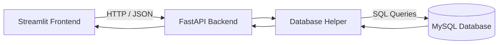
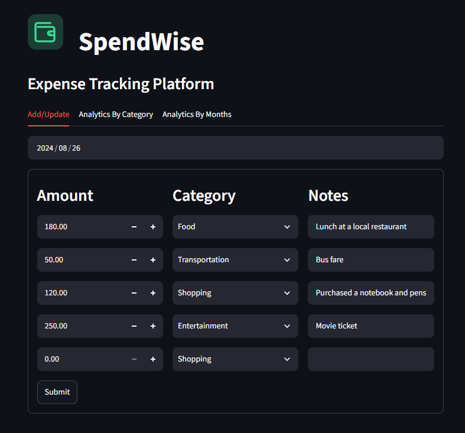
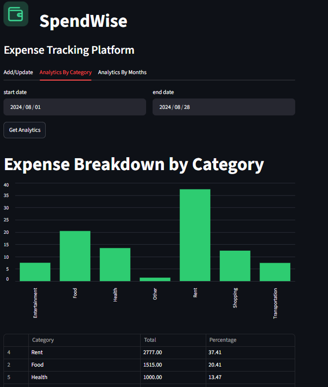
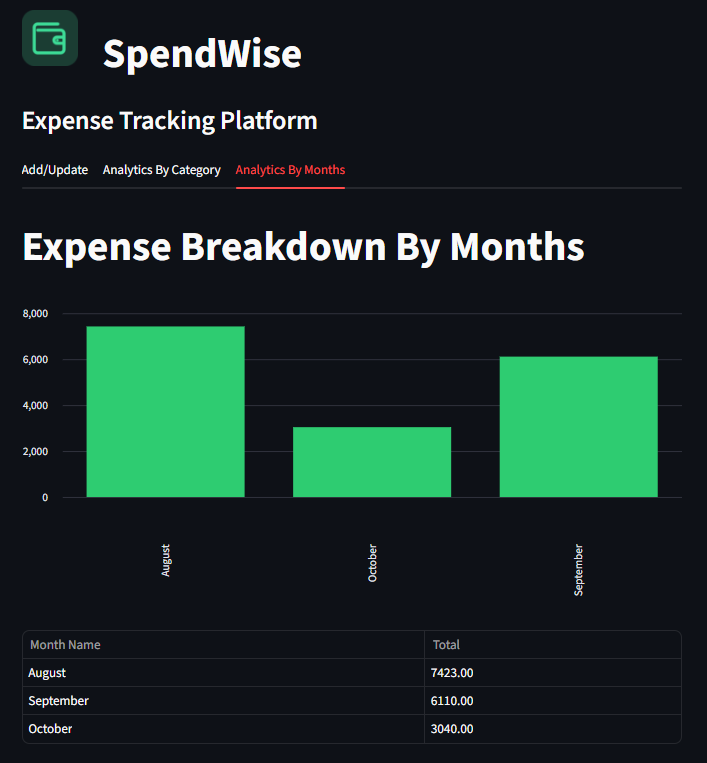

# SpendWise — Expense Tracking Platform

<div align="center">
  

  <h2>SpendWise</h2>
  <p><strong>Expense Tracking Platform</strong></p>
  <p>Log what you spend, then see exactly where your money goes.</p>

  
  
  
  
  
</div>

---

## About the Project

SpendWise is a full-stack expense tracking application that helps users record daily expenses and understand their spending habits through category-wise and monthly analytics.

The application connects a Streamlit frontend to a FastAPI backend, which communicates with a MySQL database. Users can add or update expenses, retrieve records by date, and visualize spending patterns through charts and tables.

I built this project to strengthen my understanding of Python, REST APIs, SQL, database operations, and full-stack application development.

## Features

| Feature | Description |
|---|---|
| Add & Update Expenses | Select a date, retrieve saved expenses, add new entries, edit existing records, and save changes. Supports up to five expense rows per day. |
| Category Analytics | Select a date range to view expense totals and percentage shares by category through a bar chart and table. |
| Monthly Analytics | View monthly spending summaries to understand spending patterns over time. |
| Database Integration | Store and retrieve expense records using MySQL. |
| REST API | Handle communication between the frontend and backend using FastAPI. |
| Input Validation | Validate API inputs using Pydantic models. |
| Error Handling | Display errors when API requests fail instead of silently breaking the interface. |
| Automated Tests | Use pytest to test selected database helper functions. |

**Expense categories:** Rent, Food, Shopping, Entertainment, Transportation, Health, and Other.

## Technology Stack

- **Language:** Python 3.10+
- **Frontend:** Streamlit
- **Backend:** FastAPI
- **Database:** MySQL
- **Data Processing:** Pandas
- **HTTP Requests:** Requests
- **Validation:** Pydantic
- **Testing:** Pytest
- **Version Control:** Git and GitHub

## Application Architecture



### How It Works

1. The Streamlit frontend collects user input, such as an expense date or analytics date range.
2. The frontend sends HTTP requests to the FastAPI backend using the Requests library.
3. FastAPI validates incoming data using Pydantic models and calls the database helper functions.
4. The database helper executes SQL queries against MySQL and returns the results.
5. FastAPI processes the results and returns a JSON response.
6. Streamlit converts the response into a Pandas DataFrame and displays the results as charts and tables.

## API Endpoints

| Method | Endpoint | Purpose |
|---|---|---|
| GET | `/expenses/{date}` | Retrieve expenses for a specific date. |
| POST | `/expenses/{date}` | Save the submitted expense list for a specific date. |
| POST | `/analytics/` | Retrieve category totals and percentage shares for a date range. |
| GET | `/monthly_summary/` | Retrieve monthly expense summaries. |

When the backend is running, interactive API documentation is available at:

`http://127.0.0.1:8000/docs`

## Project Structure

```text
spendwise-expense-tracker/
├── backend/
│   ├── server.py
│   ├── db_helper.py
│   └── logging_setup.py
├── frontend/
│   ├── app.py
│   ├── add_update_ui.py
│   ├── analytics_by_category.py
│   ├── analytics_by_month.py
│   └── spendwise_icon.png
├── test/
│   ├── conftest.py
│   └── backend/
│       └── test_db_helper.py
├── screenshots/
│   ├── add_update.png
│   ├── by_category.png
│   └── by_months.png
├── requirements.txt
├── LICENSE
└── README.md
```

## Getting Started

Follow these steps to run SpendWise locally.

### Prerequisites

Install the following before getting started:

- Python 3.10 or later
- MySQL Server
- Git

### 1. Clone the Repository

Replace the repository URL below with your own repository URL if necessary.

```bash
git clone https://github.com/muddassir-data/spendwise-expense-tracker.git
cd spendwise-expense-tracker
```

### 2. Create a Virtual Environment

```bash
python -m venv .venv
```

Activate the environment on Windows using Git Bash:

```bash
source .venv/Scripts/activate
```

On macOS or Linux:

```bash
source .venv/bin/activate
```

### 3. Install Dependencies

```bash
pip install -r requirements.txt
```

### 4. Configure the MySQL Database

Open MySQL Workbench or another MySQL client and execute:

```sql
CREATE DATABASE IF NOT EXISTS expense_manager;

USE expense_manager;

CREATE TABLE IF NOT EXISTS expenses (
    id INT AUTO_INCREMENT PRIMARY KEY,
    expense_date DATE NOT NULL,
    amount DECIMAL(10, 2) NOT NULL,
    category VARCHAR(50) NOT NULL,
    notes VARCHAR(255)
);
```

This creates the database and table if they do not already exist.

**Note:** If your project uses an existing database schema, retain the schema expected by your application rather than creating a conflicting table.

### 5. Configure Database Credentials

Open `backend/db_helper.py` and configure the MySQL connection with your local database username, password, host, and database name.

For a more secure setup, use environment variables or a `.env` file instead of hardcoding credentials. Never commit real passwords or database secrets to GitHub.

### 6. Start the Backend

Open a terminal in the project root, activate the virtual environment, and run:

```bash
cd backend
uvicorn server:app --reload
```

The API should be available at:

`http://127.0.0.1:8000`

Keep this terminal running.

### 7. Start the Frontend

Open a **second terminal** in the project root and activate the virtual environment if necessary.

```bash
cd frontend
streamlit run app.py
```

Streamlit will display the local application URL, typically:

`http://localhost:8501`

Keep both the backend and frontend running while using the application.

## Screenshots

### Add / Update Expenses



### Analytics by Category



### Analytics by Month



## Running Tests

Run the tests from the project root with the virtual environment activated:

```bash
pytest
```

The current tests cover selected database helper functions, including retrieving expenses for a known date, handling a date with no expenses, and calculating a summary over an empty date range.

**Testing note:** The current tests depend on the local development database. A separate test database and isolated test fixtures would make the test suite more reliable.

## Engineering Decisions

A few implementation choices helped me understand how to build a maintainable application.

- **Parameterized SQL queries:** Pass values separately from SQL statements to reduce SQL injection risks.
- **Database connection management:** Use a shared database helper and context manager to manage cursors and connections.
- **Pydantic validation:** Validate API request data before processing database operations.
- **Date-specific Streamlit widget keys:** Prevent widget state from carrying over incorrectly when the selected date changes.
- **Category fallback:** Handle unexpected categories returned by the database without crashing the form.
- **API error handling:** Check HTTP response status codes and show meaningful errors in the frontend.

## Known Limitations

- The expense form supports up to five rows per date.
- Saving replaces the submitted expense list for that date, so edits must include the complete list of expenses to retain.
- The monthly analytics view may combine the same month across different years if it groups by month name alone.
- There is no user authentication or per-user data separation.
- Database credentials require safer configuration.
- Tests use the development database rather than a dedicated test database.

## Future Improvements

Potential improvements include:

- User authentication and individual expense records.
- A separate test database with fixtures.
- Year-aware monthly analytics.
- CSV and Excel export.
- Spending forecasts and unusual-expense detection using Pandas and scikit-learn.
- Improved deployment and configuration management.

## Acknowledgements

I started this project while following a Python project course by Codebasics and extended it with my own branding, categories, error handling, analytics, and documentation.

## Author

**Muddassir Ahmad**

- GitHub: [@muddassir-data](https://github.com/muddassir-data)
- LinkedIn: [Add your LinkedIn profile URL](https://www.linkedin.com/)

---

If you find this project useful, feel free to explore the repository and share feedback.
